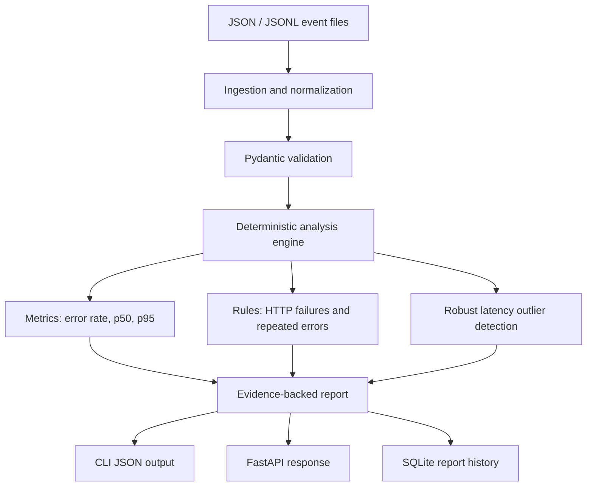

<div align="center">

# Sentinel

### A local-first Python reliability investigator for application event streams

**Detect reliability signals. Correlate evidence. Investigate incidents with less guesswork.**

[](https://github.com/ContentbyShanu/sentinel-ai-reliability/actions/workflows/ci.yml)
[](https://www.python.org/)
[](LICENSE)
[](#privacy-and-data-handling)

</div>

---

## Overview

Sentinel is a Python-first developer tool that analyzes application logs and request events to surface reliability problems that deserve investigation. It ingests JSON or JSON Lines data, normalizes common field aliases, calculates service-level metrics, applies transparent detection rules, and produces a structured report containing evidence and suggested next steps.

The goal is not to replace observability platforms. It is to make a small, reproducible reliability-analysis workflow available to developers without requiring a paid API key, hosted database, or external AI service.

### Why this problem matters

During an incident, a developer may have many log lines but little time to answer practical questions:

- Which service is producing the most errors?
- Are server-side HTTP failures clustered around a repeated message?
- Are a few requests dramatically slower than the rest?
- What evidence supports the finding?
- What should be checked next—and what is still unknown?

Sentinel organizes those signals into a report that can be saved, inspected, and used as a starting point for a human investigation.

## Key capabilities

| Capability | What it does |
|---|---|
| **Flexible ingestion** | Reads JSON objects, JSON arrays, JSONL, and common aliases such as `time`, `duration_ms`, `status`, and `route`. |
| **Input validation** | Validates timestamps, status codes, latency bounds, and required fields; fails fast by default. |
| **Reliability metrics** | Computes error rate and p50/p95 latency from the supplied events. |
| **Error-rate detection** | Flags services with a high observed error ratio when enough events exist. |
| **HTTP failure detection** | Highlights server-side status codes and summarizes their frequency. |
| **Repeated signatures** | Groups repeated normalized error messages within each service. |
| **Latency outliers** | Uses median and median absolute deviation (MAD) to identify unusually slow observations. |
| **Evidence-first findings** | Each finding includes severity, confidence, evidence, event count, and recommended investigation steps. |
| **CLI and API** | Supports terminal workflows and a FastAPI interface for integrations. |
| **Local report history** | Stores report JSON in SQLite, with endpoints to list and retrieve reports. |
| **Quality workflow** | Includes pytest tests, Ruff linting, Docker configuration, and GitHub Actions CI. |

## Architecture



### Engineering choices

- **Python 3.11+** provides modern typing and standard-library support.
- **Pydantic** validates event and report contracts.
- **FastAPI** exposes an optional API without coupling the analysis engine to HTTP.
- **SQLite** keeps report history local and simple to inspect.
- **Median absolute deviation** is less sensitive to extreme values than standard-deviation-only thresholds.
- **Deterministic rules** make findings reproducible and easier to test than unconstrained text generation.

The analysis engine is deliberately separated from ingestion, persistence, CLI, and API layers. This allows each layer to be tested independently and makes future adapters easier to add.

## Quick start

### Requirements

- Python 3.11 or newer
- pip
- No API key required
- No cloud account required for local use

### 1. Create an environment

```bash
python -m venv .venv
```

Activate it:

```bash
# Windows PowerShell
.venv\Scripts\Activate.ps1

# macOS / Linux
source .venv/bin/activate
```

### 2. Install Sentinel

```bash
python -m pip install --upgrade pip
python -m pip install -e ".[dev]"
```

### 3. Analyze the included example

```bash
sentinel analyze examples/sample_events.jsonl --pretty
```

Save the report to a file:

```bash
sentinel analyze examples/sample_events.jsonl \
  --output reports/sample-report.json \
  --database sentinel.db
```

On Windows PowerShell, the command may be entered on one line if shell line continuation differs.

### 4. Run tests

```bash
pytest --cov=sentinel --cov-report=term-missing
ruff check .
```

## Example output

The exact report ID and generated timestamp vary per run. A report includes fields like:

```json
{
  "report_id": "R-example",
  "source": "sample_events.jsonl",
  "total_events": 7,
  "services_analyzed": ["catalog-api", "checkout-api"],
  "error_rate": 0.4286,
  "p50_latency_ms": 420.0,
  "p95_latency_ms": 1920.0,
  "findings": [
    {
      "kind": "repeated_error",
      "severity": "medium",
      "title": "Repeated error signature in checkout-api",
      "evidence": [
        "Signature: database connection timeout",
        "Endpoint: /checkout."
      ],
      "confidence": 0.77
    }
  ]
}
```

This is an illustrative excerpt, not a guaranteed literal output. Metrics are computed from the sample fixture at runtime.

## CLI reference

### Analyze a file

```bash
sentinel analyze PATH
```

Options:

| Option | Description |
|---|---|
| `--pretty` | Pretty-print JSON output. |
| `--output PATH` / `-o PATH` | Write a JSON report to a file. |
| `--database PATH` | Save the report in SQLite for later retrieval. |
| `--skip-invalid` | Skip malformed rows. Use cautiously because skipped rows are not included in metrics. |
| `--version` | Print the installed version. |

### Browse report history

```bash
sentinel history --database sentinel.db --limit 20
```

The limit must be between 1 and 100.

## HTTP API

Start the API:

```bash
uvicorn sentinel.api:app --reload
```

Open the interactive API documentation at `http://127.0.0.1:8000/docs`.

### `GET /health`

Returns a lightweight liveness response.

```json
{"status": "ok", "service": "sentinel"}
```

### `POST /v1/analyze`

Example request:

```json
{
  "source": "checkout-sample",
  "events": [
    {
      "timestamp": "2026-10-27T09:00:00Z",
      "service": "checkout-api",
      "level": "ERROR",
      "message": "database connection timeout",
      "latency_ms": 1200,
      "status_code": 503,
      "request_id": "req-101",
      "endpoint": "/checkout"
    }
  ]
}
```

Example curl command:

```bash
curl -X POST "http://127.0.0.1:8000/v1/analyze" \
  -H "Content-Type: application/json" \
  -d '{"source":"local-test","events":[{"timestamp":"2026-10-27T09:00:00Z","service":"checkout-api","level":"ERROR","message":"database connection timeout","latency_ms":1200,"status_code":503}]}'
```

The API accepts 1–20,000 event records per request. Invalid event payloads return HTTP 422.

### `GET /v1/reports?limit=20`

Lists saved report metadata. The `limit` query parameter accepts 1–100.

### `GET /v1/reports/{report_id}`

Returns a saved report, or HTTP 404 if no matching report exists.

### API storage configuration

The database defaults to `./sentinel.db`. Set `SENTINEL_DB_PATH` to use another path.

> **Security note:** The API is designed for local development. Do not expose it directly to the public internet without authentication, TLS, rate limiting, and a deployment security review.

## Docker

Build and run the API with Docker Compose:

```bash
docker compose up --build
```

The API is available at `http://127.0.0.1:8000`. SQLite data is stored in the named `sentinel-data` volume.

Stop the service:

```bash
docker compose down
```

## How detection works

### Error-rate signal

Sentinel classifies an event as an error when its level is `ERROR`, `FATAL`, or `CRITICAL`, or its status code is 500 or above. A service-level error-rate finding is emitted when at least three events are present and at least 30% are error-classified.

These thresholds are starter defaults, not universal SLOs. Tune them for the workload before using reports in operational decisions.

### HTTP failure signal

Server-side status codes are summarized by frequency. The report points to example endpoints when those fields are present.

### Repeated error signatures

Error messages are lowercased and trimmed before grouping. This simple normalization is transparent but does not yet remove variable IDs, timestamps, or stack-trace fragments from message signatures.

### Latency anomaly signal

For each service with at least five latency observations, Sentinel calculates the median and median absolute deviation (MAD). A request is flagged when it exceeds the median plus a conservative threshold based on MAD, the median, and a 100 ms floor.

This is a heuristic, not a statistically calibrated alerting model. Workloads with naturally heavy-tailed latency distributions may need custom thresholds or time-window baselines.

### Confidence and severity

Confidence values are rule-based indicators of signal strength, not calibrated probabilities. Severity is a triage suggestion and should be interpreted alongside business impact, SLOs, traces, and deployment context.

## Testing and quality

The repository includes tests for:

- timestamp normalization and common field aliases
- malformed JSON and optional invalid-row skipping
- percentile interpolation
- error spikes, HTTP failures, and repeated messages
- latency outlier detection
- empty inputs
- SQLite persistence
- API health and analysis validation

GitHub Actions runs linting and tests against Python 3.11 and 3.12 for pushes and pull requests.

## Repository layout

```text
sentinel-ai-reliability/
├── .github/workflows/ci.yml
├── examples/
│   ├── README.md
│   └── sample_events.jsonl
├── src/sentinel/
│   ├── __init__.py
│   ├── analysis.py
│   ├── api.py
│   ├── cli.py
│   ├── ingest.py
│   ├── models.py
│   ├── service.py
│   └── storage.py
├── tests/
│   ├── test_analysis.py
│   ├── test_api.py
│   ├── test_ingest.py
│   └── test_storage.py
├── .env.example
├── .gitignore
├── CONTRIBUTING.md
├── Dockerfile
├── LICENSE
├── README.md
├── SECURITY.md
├── docker-compose.yml
└── pyproject.toml
```

## Privacy and data handling

Sentinel runs locally and does not transmit telemetry to a third-party service. However, event files and reports may contain sensitive operational data. Prefer synthetic or sanitized logs. Restrict access to report files and the SQLite database.

The default API has no authentication. Keep it bound to localhost for personal use.

## Current limitations

- No native integrations with cloud providers, Kubernetes, OpenTelemetry collectors, or commercial observability products.
- No distributed trace reconstruction.
- No learned causal model; temporal association is explicitly labeled as correlation.
- No calibrated confidence probabilities.
- No automatic remediation or production changes.
- No multi-tenant authentication or role-based access control.
- The initial SQLite storage layer is intended for local workflows, not high-concurrency deployments.
- Latency thresholds need workload-specific validation.

These boundaries are documented deliberately. A reliable tool should make its assumptions visible rather than imply that a heuristic is a definitive diagnosis.

## Roadmap

- [ ] Time-window baselines and configurable per-service thresholds
- [ ] Better error-signature normalization for IDs and stack traces
- [ ] OpenTelemetry JSON adapters and trace/request correlation
- [ ] Export formats for Markdown and HTML incident reports
- [ ] Baseline-versus-current regression comparison
- [ ] Optional local language-model summaries with no mandatory hosted API
- [ ] Benchmark suite with labeled synthetic incidents and precision/recall metrics
- [ ] API authentication and deployment hardening for shared environments

Roadmap items are planned, not currently implemented.

## Contributing

See [CONTRIBUTING.md](CONTRIBUTING.md) for setup and quality checks. Please use synthetic data and never commit credentials or production logs.

## License

Distributed under the MIT License. See [LICENSE](LICENSE).

---

**Sentinel is an engineering prototype for evidence-backed reliability investigation.** It is intended to help developers decide what to inspect next—not to replace production monitoring, on-call judgment, or a formal incident response process.

[**Live Website Demo**](https://contentbyshanu.github.io/sentinel-ai-reliability/) · [GitHub Repository](https://github.com/ContentbyShanu/sentinel-ai-reliability)
